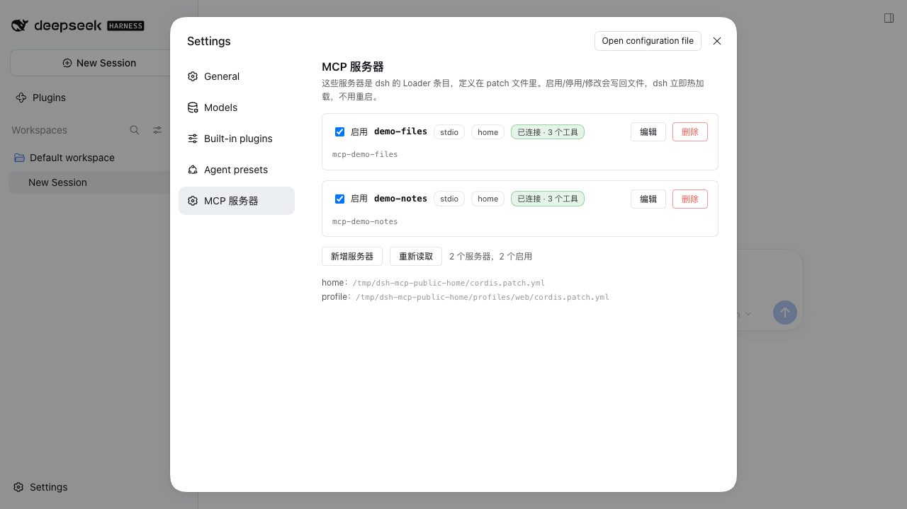
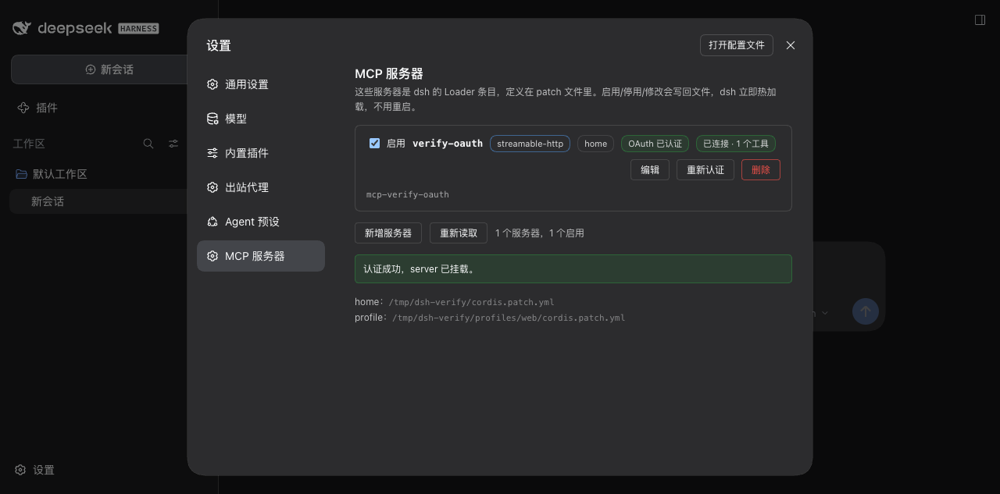

# dsh-mcp-config

在 DeepSeek Harness（dsh）的 **Settings → MCP 服务器** 里管理 MCP server：启用/停用、新增、编辑、删除，以及**测试连接（验证认证是否有效）**。

改完立即生效——不需要重启 dsh。





---

## 为什么需要它

dsh 把每个 MCP server 实现成一个 Loader 条目（插件 `@deepseek-ai/dsh-mcp-client`），写在用户 patch 文件里：

| 文件 | 作用范围 |
|------|----------|
| `$DSH_HOME/cordis.patch.yml` | 所有 profile（desktop / web / headless） |
| `$DSH_HOME/profiles/<name>/cordis.patch.yml` | 只对某个 profile |

官方 Settings 只提供「有 volatile 配置字段的插件」的表单，MCP 条目不属于这类，所以改一个 server 只能手改 YAML 再重启。

这个插件补上这块：它**直接读写这两个 patch 文件**，剩下的交给 dsh 自己的机制——dsh 的 HMR 会监听这两个文件，文件一变就调用 Loader 的 `reconcileProfilePatches`，于是 server 被挂载/卸载/重建。所以插件本身不持有 server 列表，也不自己 spawn 任何进程，只做「文件编辑 + 状态汇报 + 连接探测」。

> 同类第三方插件 `@xxxyz/dsh-mcp-manager@2.2.7` 的 `peerDependencies` 是 `@deepseek-ai/dsh-tools@^0.1.2-rc.1`，在 dsh `0.2.0-rc.2` 上会被启动检查拒绝，装上也跑不起来——这是本插件存在的原因。

---

## 前置条件

- dsh `>= 0.2.0-rc.2`（`dsh --version` 确认）
- 能用 Web / Desktop 界面（本插件的页面是 Web 客户端 bundle，`dsh.client.platform = web`）

依赖解析说明：`yaml`、`@modelcontextprotocol/client`、`@deepseek-ai/dsh-subprocess` 都从 **dsh 安装目录**解析（`profileContext.installAnchor`，兜底 `which dsh`），不从插件自己的 `node_modules` 解析。所以插件不需要自己装这些包。

---

## 安装（给同事）

**零运行时依赖**：`yaml`、`@modelcontextprotocol/client`、`@deepseek-ai/dsh-subprocess` 全部从 dsh 安装目录解析，克隆后**不需要 `npm install`，也不需要访问 registry**。只要 dsh 版本够（≥ `0.2.0-rc.2`；Desktop App 内置 `0.2.1-rc.2`，homebrew CLI 是 `0.2.0-rc.2`，两者都行）。

### Web / headless profile

```bash
# 直接从仓库装（pnpm 会 clone 整个仓库；推荐）
dsh plugin --profile web add https://github.com/ianzheng001/dsh-mcp-config

# 或者先 clone，再按本地绝对路径装（开发时用这个，改代码只需重启）
git clone https://github.com/ianzheng001/dsh-mcp-config ~/git/dsh-mcp-config
dsh plugin --profile web add ~/git/dsh-mcp-config
```

`dsh plugin add` 读到包里的 `dsh.bundle.patch` 会自动把 `dsh-mcp-config` 加进 profile 的 bundle 栈；bundle patch 只 **insert** 一条自己的 row（`mcp-config`），不动别人的条目。

### Desktop（DeepSeek Harness.app）

Desktop 走独立的 `desktop` profile，而且 **homebrew 的 dsh 会拒绝操作它**（`profile "desktop" is managed exclusively by the Electron application`）。

**推荐：用 App 自己的插件面板**——左侧「插件」→ 添加插件 → 粘贴仓库地址（或 clone 后的本地绝对路径）。这是 App 管理的路径，装完它会自己提示重载。

不想点 UI 的话，App 自带的 CLI 带 `manageDesktopProfile` 权限，可以操作 desktop profile：

```bash
# 1) 完全退出 App（Cmd+Q，确认进程消失）
# 2) 装（注意是 App 自带的 dsh，不是 homebrew 的）
"/Applications/DeepSeek Harness.app/Contents/Resources/runtime/cli/bin/dsh" \
  plugin --profile desktop add https://github.com/ianzheng001/dsh-mcp-config
# 3) 重新打开 App
open -a "DeepSeek Harness"
```

### 生效

装完**重启一次** dsh / App（Host 半段没有 HMR，只有插件树热更新）。之后在设置里改 MCP server 都即时生效，不用重启。

### 卸载

```bash
dsh plugin --profile web remove dsh-mcp-config
# Desktop：用 App 自带 CLI（同上路径）或插件面板卸载
```

---

## 用法

打开 **Settings → MCP 服务器**，每个 server 一张卡片：

| 操作 | 说明 |
|------|------|
| 启用 / 停用 | 勾选框。写入/清除该行的 `disabled`，Loader 立刻卸载或挂载 |
| 编辑 | 改 id、serverName、transport（stdio / streamable-http）、command/args/cwd/env 或 url/headers、toolCallTimeoutMs |
| 删除 | 点一次变「确认删除」，4 秒内再点一次才真正删除（删的是 patch 文件里的行） |
| 测试连接 | 用当前编辑中的配置**新开一条临时 MCP 会话**：握手 + `tools/list`，回报 server 名称/版本/工具数，或精确错误（401、ENOENT、超时……） |
| 新增服务器 | 选择写入 home（所有 profile）或当前 profile；建议先「测试连接」再「创建」 |
| 重新读取 | 外部（手改 YAML / git 切分支）改动后刷新页面状态 |

### 认证

#### 静态凭据

- `stdio` server → 写在 `env`（比如 `MY_AUTH_ACCOUNT`），或由 server 自己走浏览器 SSO；
- `streamable-http` server → 写在 `headers`（比如 `Authorization: Bearer <token>`）。

key 命中 `token/secret/password/authorization/cookie/...` 的值默认掩码，点「显示」才展开。

**「测试连接」也是认证校验**：握手成功 = 凭据有效；失败会原样返回上游错误（例如 `HTTP 401 invalid_token`）和子进程 stderr 尾部。它开的是独立连接，不会打断模型当前正在用的那条。

#### 交互式 OAuth（一键认证）

dsh 的 MCP client 本身只吃静态 header，所以插件自己跑授权码流程，再把拿到的 access token 写成该服务器的 `Authorization` 头：

1. 点卡片上的「认证」→ 插件用 MCP SDK 的 `OAuthClientProvider` 发一次真实握手；
2. 服务器回 `401` + `WWW-Authenticate` → SDK 做 RFC 9728 资源元数据发现 → RFC 8414 授权服务器发现 → 需要时动态客户端注册（DCR）→ PKCE 生成授权 URL；
3. 浏览器打开授权 URL，你登录/同意；授权服务器回调到 dsh 自己的 loopback 路由 `/dsh-mcp-config/oauth/callback`；
4. 插件换 token → 写入 patch 的 `headers.Authorization: Bearer …` → Loader 热加载 → 页面变「OAuth 已认证 / 已连接 · N 个工具」。

凭据（client 注册信息、token、PKCE verifier、发现状态）存在 `<DSH_HOME>/mcp-config-oauth.json`，权限 `0600`，不进 patch 文件。

- **授权服务器不支持动态注册**（企业 OIDC 常见）：在编辑面板填 `OAuth client id / client secret`，会随认证流程提交并记住。
- **token 过期**：live 连接用的是静态 header，过期后会掉线，页面上点「重新认证」即可（SDK 会用 refresh token 刷新）。
- 「重新认证」按钮在 `streamable-http` 卡片上；`stdio` 服务器不需要 OAuth。

### 写入位置

- **编辑/启停/删除**：写在该行**当前所在**的文件，不做跨文件复制。
- **新增**：默认写 home 层；界面可切到当前 profile。

注意 home 层对所有 profile 生效，所以停用一个 home 层 server 也会影响 desktop / headless profile。

---

## 安全边界

- 页面通过 `POST /dsh-mcp-config/api`（同源、仅 loopback）与 Host 通信，没有额外鉴权：和 dsh 自身 Settings 一致，**不要**把 dsh 的 Web 端口暴露到非信任网络。
- 凭据以明文保存在 patch 文件里（和手写 YAML 一样）。写入保留原文件权限位；新建文件用 `0600`。
- 写文件是「临时文件 + rename」的原子写，Loader watcher 不会看到半截文件；每次写入带 SHA-256 前置校验，文件被别处改过时拒绝覆盖并回读提示。

---

## 开发

```bash
npm test          # 36 项：patch 层 / Host 路由端到端 / 真实 stdio 握手 / bundle 形态 / OAuth 全链路
npm run harness   # 本地 UI 验证页（会复制真实 patch 到临时目录，绝不写你的真配置）
```

- `lib/patch.js` — YAML patch 行的纯操作（注入 `yaml` 模块，可单测；保留注释与 `!!js` tag）
- `lib/probe.js` — 一次性的 MCP 探测会话（独立于实连接）
- `lib/index.js` — Host 半段：`/dsh-mcp-config/api` 路由、状态合并、写入、校验
- `lib/client.js` — 浏览器半段：手写 CJS factory（`window.__ModuleLoader__.load`），无需构建步骤
- `test/harness/` — 用 esbuild 打一个 React 测试页，接真实 Host 逻辑

Host 半段没有 HMR：改 `lib/index.js` 需要重启 dsh；改 `lib/client.js` 会被 dsh 的 client-hmr（500ms 轮询 bundle 文件）热替换，刷新设置页即可。

### 坑：client bundle 必须整体包在 IIFE 里

Web shell 不是每个插件一个 `<script>`——它把同一批缺失的 bundle 拼成一个 combo URL（`/plugins/??a/client.js,b/client.js`）塞进**同一个顶层作用域**执行。所以顶层 `const factory = ...` 一旦出现两次，整个 combo 就 `Identifier 'factory' has already been declared`，这一批所有插件全部 import 失败，而且报错只说 "import failed (see console for the import error)"，不给细节。

`test/bundle.test.mjs` 用「把自己的 bundle 和一份同形状的兄弟 bundle 拼起来再编译」把这条约束钉住了。手写 CJS bundle 时照抄这个结构：

```js
;(() => {           // ← 顶层不留任何绑定
  const factory = (require) => { ... }
  window.__ModuleLoader__.load({ id: '<loader entry id>', factory })
  window.__ModuleLoader__.load({ id: '<package name>', factory })
})()
```

注册 id 要同时给 **Loader 条目 id**（如 `mcp-config`）和**包名**（`dsh-mcp-config`）：client runner 按条目 id 导入，包名那份是兼容性兜底。

## 验证记录（2026-10-18）

- `npm test`：29/29 通过（含真实 stdio MCP 握手、坏 command 的错误回报、bundle 拼接编译）
- UI harness（esbuild + 真实 React）：创建 / 编辑 / 删除（两步确认）/ 启停 / 测试连接 / 密钥掩码全部走通
- **隔离 DSH_HOME 的真实 dsh 实例**（`dsh --profile web --port 65498`，只挂一条 dummy MCP server）：设置页出现「MCP 服务器」→ 显示 `已连接 · 1 个工具`（读真实工具注册表）→ 停用后 `ToolCount` 归零 → 重新启用恢复 → 通过 API 新建 profile 层 server 5 秒内热挂载 → 删除后热卸载且 `- insert:` 空块被清掉
- **OAuth 全链路（真实实例 + 本地 mock 授权服务器）**：点「认证」→ 授权页 → 回调 → token 写入 patch → 热加载 → `OAuth 已认证 / 已连接 · 1 个工具`。mock 同时覆盖 401 挑战、DCR、PKCE、token 失败路径

---

## 已知限制

- 不支持 OAuth 认证（上游 dsh MCP client 限制）。
- 不能管理由 bundle/插件包自带的 MCP 条目（卡片标 `plugin`、只读）。
- 不支持给单个 profile 覆盖 home 层某个 server 的配置（启停是原地写 `disabled`）。
- 不支持从 `.mcp.json` 一键导入（home 层 patch 目前就是它的镜像，需要时手工加）。
